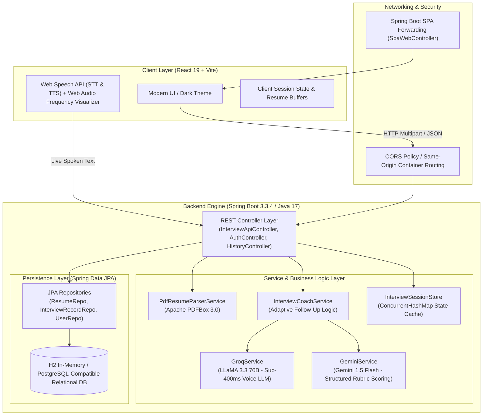
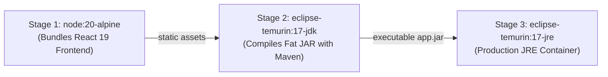

# MockMate AI — Autonomous Voice & Resume AI Interviewer

[](https://openjdk.org/)
[](https://spring.io/projects/spring-boot)
[](https://spring.io/projects/spring-data-jpa)
[](https://react.dev/)
[](Dockerfile)
[](src/test/java)

> **Enterprise-grade full-stack mock interview platform** built with **Java 17**, **Spring Boot 3**, **Spring Data JPA**, and **React 19**. MockMate AI conducts live, voice-driven technical interviews tailored to a candidate's uploaded resume, evaluates technical depth with adaptive follow-up questioning, and generates a structured rubric scorecard persisted via relational JPA entities.

---

## 📌 Table of Contents
- [System Architecture](#-system-architecture)
- [Why I Built This (Problem Statement)](#-why-i-built-this-problem-statement)
- [Core Engineering Pillars](#-core-engineering-pillars)
- [End-to-End Interview Workflow](#-end-to-end-interview-workflow)
- [REST API Specification](#-rest-api-specification)
- [Relational Data Model (JPA Schema)](#-relational-data-model-jpa-schema)
- [Engineering Trade-Offs & Decisions](#-engineering-trade-offs--decisions)
- [Automated Testing & Quality](#-automated-testing--quality)
- [Getting Started Locally](#-getting-started-locally)
- [Containerized Deployment (Docker)](#-containerized-deployment-docker)
- [Author & Connect](#-author--connect)

---

## 🏛️ System Architecture

MockMate AI follows a clean, decoupled **Layered Monolith / Client-Server Architecture** designed for high throughput, sub-second audio response, and strict type safety:



---

## 🎯 Why I Built This (Problem Statement)

Most candidates prepare for technical interviews by solving LeetCode problems or memorizing canned conceptual answers. However, real-world technical interviews present challenges that static prep cannot replicate:

1. **Contextual Pressure**: Interviewers don't query generic trivia; they interrogate architecture choices, claimed metrics, and specific libraries straight from your resume.
2. **Adaptive Follow-Up Interrogation**: When a candidate gives a shallow or vague explanation, a senior engineer digs deeper (*"Why did you choose PostgreSQL over MongoDB for that transactional service?"*).
3. **Conversational Fluency**: Communicating technical trade-offs verbally while under time pressure is a distinct skill from typing code in an editor.

**MockMate AI bridges this gap**: It extracts real project experience from candidate PDF resumes on the server, generates custom question pools, conducts a real-time vocal interview with dynamic follow-up questioning, and outputs an executive scorecard highlighting strengths and blind spots.

---

## ⚡ Core Engineering Pillars

### 1. Java 17 & Spring Boot 3 REST Core
* Built on Spring Boot 3.3.4 leveraging **Java 17 modern features** (Records, pattern matching, Stream API, and immutability).
* Strict layering separating concerns: Controller (`@RestController`), Service (`@Service`), and Repository (`@Repository`).
* Comprehensive Global Exception Handling and contract DTOs preventing internal database schema leaks.

### 2. Zero-Disk In-Memory PDF Parsing (Apache PDFBox 3.0)
* Rather than uploading resumes to third-party disk storage or relying on client-side JS PDF readers, resumes are streamed directly into an `InputStream`.
* Apache PDFBox extracts raw layout streams and filters key technologies (Java, Spring, Microservices, React, Docker, AWS, SQL) using heuristic pattern matchers.

### 3. Ultra-Low Latency Voice Interaction (<400ms TTFT)
* Traditional LLM API calls take 2 to 4 seconds, which completely breaks conversational interview rhythm.
* MockMate AI integrates **Groq Cloud (LLaMA 3.3 70B Versatile)** for dynamic conversational turns, delivering sub-400ms time-to-first-token (TTFT).
* The browser utilizes native **Web Speech API** for instant Speech-to-Text (STT) and natural Text-to-Speech (TTS), eliminating expensive audio streaming round-trips.

### 4. Relational Persistence via Spring Data JPA & Hibernate 6
* Relational persistence backed by Hibernate 6 and Spring Data JPA.
* Automatically creates relational schemas on startup and exposes a local query console via `/h2-console` for inspection.
* Zero-configuration development out of the box, with instant drop-in compatibility for production **PostgreSQL**.

---

## 🔄 End-to-End Interview Workflow

1. **Candidate Onboarding & Resume Parsing**:
   * The candidate uploads their PDF resume.
   * Spring Boot receives `multipart/form-data`, parses raw text via Apache PDFBox, and extracts claimed skills and estimated experience level.
2. **Dynamic Question Pool Synthesis**:
   * Based on the candidate's target role and parsed skill profile, the backend prepares a balanced question pool:
     * **Warmup**: Professional introduction & background overview.
     * **Fundamentals**: Core engineering foundations & system design.
     * **Specialized Deep-Dive**: Project-specific questions based on the candidate's actual resume technologies.
3. **Conversational Interview Loop**:
   * The AI interviewer speaks the question aloud using TTS.
   * The candidate answers naturally using their microphone; real-time audio waveforms are rendered via the Web Audio API.
   * Spoken responses are submitted to `POST /api/interview/evaluate-answer`.
   * The engine scores response depth: if an answer is shallow, it triggers an **adaptive follow-up** to probe understanding; if comprehensive, it advances to the next technical phase.
4. **Comprehensive Executive Evaluation**:
   * On completion, all interview turns, timestamps, and transcripts are synthesized.
   * A structured evaluation is computed across Technical Correctness, Communication Clarity, System Reasoning, and Problem Solving.
   * The record is saved to the database via `InterviewRecordEntity`.

---

## 📡 REST API Specification

| HTTP Method | Endpoint | Description | Request Payload / Params | Response Format |
|---|---|---|---|---|
| `GET` | `/api/status` | System health, JPA connection & AI service readiness check | None | JSON status object |
| `POST` | `/api/resume/parse` | Server-side binary PDF resume extraction & skill analysis | `file: MultipartFile` | `CandidateProfile` JSON |
| `POST` | `/api/resume/parse-text` | Raw plain-text resume parsing fallback | `{"rawText": "..."}` | `CandidateProfile` JSON |
| `POST` | `/api/interview/questions` | Synthesizes role-tailored technical question pool | `CandidateProfile` JSON | `QuestionPool` JSON |
| `POST` | `/api/interview/evaluate-answer` | Evaluates candidate answer & generates dynamic follow-up | `{"question":"...","answer":"..."}` | Evaluation & Follow-Up JSON |
| `POST` | `/api/interview/report` | Computes comprehensive interview scorecard | Transcript turns array | `EvaluationReport` JSON |
| `GET` | `/api/history` | Fetches historical interview records from database | None | Array of `InterviewRecordEntity` |
| `POST` | `/api/auth/signup` | Registers candidate account with BCrypt password hashing | `{"email":"...","password":"..."}` | Auth Token & User DTO |
| `POST` | `/api/auth/login` | Authenticates candidate account | `{"email":"...","password":"..."}` | Auth Token & User DTO |

### Example: Health Check Response (`GET /api/status`)
```json
{
  "status": "UP",
  "service": "MockMate AI Spring Boot Backend",
  "version": "1.0.0",
  "jpaConnected": true,
  "totalResumesSaved": 12,
  "totalInterviewsSaved": 8,
  "groqConfigured": true,
  "geminiConfigured": true,
  "groqModel": "llama-3.3-70b-versatile",
  "geminiModel": "gemini-1.5-flash"
}
```

---

## 🗄️ Relational Data Model (JPA Schema)

```
┌────────────────────────┐         ┌────────────────────────┐
│      users             │         │      resumes           │
├────────────────────────┤         ├────────────────────────┤
│ id (PK, Long)          │1       *│ id (PK, Long)          │
│ email (VARCHAR, Unique)│─────────│ user_id (VARCHAR)      │
│ name (VARCHAR)         │         │ candidate_name(VARCHAR)│
│ password (VARCHAR)     │         │ target_role (VARCHAR)  │
│ created_at (TIMESTAMP) │         │ extracted_skills (CLOB)│
└────────────────────────┘         │ raw_resume_text (CLOB) │
                                   │ created_at (TIMESTAMP) │
                                   └────────────────────────┘
                                               │
                                               │ 1
                                               │
                                               │ *
                                   ┌────────────────────────┐
                                   │   interview_records    │
                                   ├────────────────────────┤
                                   │ id (PK, Long)          │
                                   │ user_id (VARCHAR)      │
                                   │ target_role (VARCHAR)  │
                                   │ overall_score (INT)    │
                                   │ technical_score (INT)  │
                                   │ communication_score(INT│
                                   │ executive_feedback(CLOB│
                                   │ created_at (TIMESTAMP) │
                                   └────────────────────────┘
```

---

## ⚖️ Engineering Trade-Offs & Decisions

| Decision Area | Selected Approach | Alternative Considered | Technical Rationale |
|---|---|---|---|
| **PDF Resume Parsing** | Server-side Apache PDFBox 3.0 | Client-side `pdf.js` in browser | Prevents heavy bundle size on mobile devices, normalizes complex multi-column resumes reliably, and guarantees consistent server extraction before LLM ingestion. |
| **Voice Processing** | Web Speech API (STT & TTS) | Whisper API + ElevenLabs API | Audio streaming across third-party speech APIs introduces 2-3 seconds of network round-trip overhead and high token costs. Web Speech API runs on-device with zero network latency. |
| **Conversational LLM** | Groq LLaMA 3.3 70B | GPT-4o / Claude 3.5 Sonnet | Groq LPUs achieve ~400ms time-to-first-token. In an interactive vocal interview, latency is the primary driver of perceived human realism. |
| **Session State** | `ConcurrentHashMap` Thread-Safe Store | Redis / External Cache | For single-instance runtime and local deployment, an in-memory concurrent store eliminates external network hops and setup complexity while remaining fully thread-safe. |
| **Data Transfer** | Strict separation of DTOs & JPA Entities | Exposing JPA Entities in Controller | Exposing entities directly leads to circular JSON serialization issues, tight coupling, and unintended entity modifications. DTOs enforce a strict contract. |

---

## 🧪 Automated Testing & Quality

MockMate AI includes unit and integration tests powered by **JUnit 5**, verifying component resilience, boundary conditions, and mock profile synthesis:

```bash
# Execute test suite
mvn test
```

### Verified Test Suite Results:
```text
[INFO] -------------------------------------------------------
[INFO]  T E S T S
[INFO] -------------------------------------------------------
[INFO] Running com.mockmate.ai.MockMateAiApplicationTests
[INFO] Tests run: 1, Failures: 0, Errors: 0, Skipped: 0 - Spring Context Bootstrapped
[INFO] Running com.mockmate.ai.service.PdfResumeParserServiceTest
[INFO] Tests run: 1, Failures: 0, Errors: 0, Skipped: 0 - Resilience on Corrupted Streams
[INFO] Running com.mockmate.ai.service.InterviewSessionStoreTest
[INFO] Tests run: 2, Failures: 0, Errors: 0, Skipped: 0 - Concurrent Session Isolation
[INFO] 
[INFO] Results:
[INFO] Tests run: 4, Failures: 0, Errors: 0, Skipped: 0
[INFO] BUILD SUCCESS
```

---

## 🚀 Getting Started Locally

### Prerequisites
* **Java 17 or higher** (JDK)
* **Maven 3.8+** *(or use bundled Maven in `maven/`)*
* **Node.js 18+** & **npm**

### 1. Clone Repository
```bash
git clone https://github.com/prajakta2905/MockMateAI.git
cd MockMateAI
```

### 2. Environment Configuration
Create a `.env` file in the project root:
```env
# AI Model Keys (Optional for local testing; offline question pool fallback is included)
GROQ_API_KEY=gsk_your_groq_api_key_here
GEMINI_API_KEY=your_gemini_api_key_here
```

### 3. Launch Application

#### **Windows (1-Click Launch)**
Double-click [`start-all.bat`](start-all.bat) or run in terminal:
```cmd
start-all.bat
```
*(Starts Spring Boot backend on port 8080 and React frontend on port 5173 concurrently).*

#### **Linux / macOS (Manual Launch)**
Terminal 1 — Backend:
```bash
mvn clean spring-boot:run
```
Terminal 2 — Frontend:
```bash
cd frontend
npm install
npm run dev
```

* 🌐 **Frontend UI**: `http://localhost:5173`
* 🔌 **Backend REST API**: `http://localhost:8080/api/status`
* 🗃️ **H2 Database Console**: `http://localhost:8080/h2-console` *(JDBC URL: `jdbc:h2:mem:mockmatedb`, User: `sa`, Password: empty)*

---

## 🐳 Containerized Deployment (Docker)

MockMate AI includes an enterprise **multi-stage Docker build** that produces a lightweight, secure production container running both the React frontend and Spring Boot backend as a unified service:



### Build & Run Container
```bash
# 1. Build production image
docker build -t mockmate-ai .

# 2. Run container
docker run -p 8080:8080 -e PORT=8080 mockmate-ai
```
The full application (React UI + Spring Boot REST API) will be live at `http://localhost:8080`.

---

## 👩‍💻 Author & Connect

**Prajakta Gudadhe**  
*Full Stack Software Engineer & Java Developer*

* 🐙 **GitHub**: [@prajakta2905](https://github.com/prajakta2905)
* 📧 **Email**: [prajaktagudadhe068@gmail.com](mailto:prajaktagudadhe068@gmail.com)
* 💼 **Project Repository**: [https://github.com/prajakta2905/MockMateAI](https://github.com/prajakta2905/MockMateAI)

---

<p align="center">
  <sub>Developed with passion for engineering rigor, clean code architecture, and high-performance full-stack systems.</sub>
</p>
