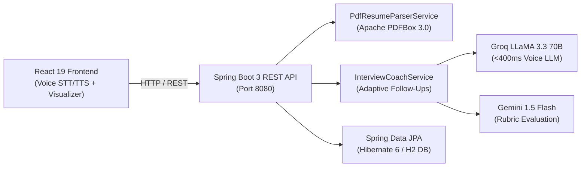

# MockMate AI — Autonomous Voice & Resume AI Interviewer

[](https://openjdk.org/)
[](https://spring.io/projects/spring-boot)
[](https://spring.io/projects/spring-data-jpa)
[](https://react.dev/)
[](Dockerfile)
[](src/test/java)

An enterprise full-stack mock interview platform built with **Java 17**, **Spring Boot 3**, **Spring Data JPA**, and **React 19**. MockMate AI conducts live, voice-driven technical interviews tailored to a candidate's uploaded resume, evaluates technical depth with adaptive follow-up questions, and generates a structured scorecard persisted in a relational database.

---

## 🏛️ Architecture Overview



---

## ⚡ Core Engineering Highlights

* **Java 17 & Spring Boot 3 Core**: Clean layered architecture (`Controller` ➔ `Service` ➔ `Repository`) with DTO abstraction, global exception handling, and type-safe REST contracts.
* **In-Memory PDF Resume Parsing**: Uses **Apache PDFBox 3.0** on the server to extract skills and project experience from binary streams without saving files to disk.
* **Low-Latency Voice Engine (<400ms TTFT)**: Combines browser-native **Web Speech API** (STT/TTS) with **Groq Cloud (LLaMA 3.3 70B)** to achieve fluid conversational latency.
* **Relational Persistence**: Uses **Spring Data JPA** & **Hibernate 6** to persist user accounts, extracted resumes, and completed interview scorecards. Includes an interactive web console at `/h2-console`.
* **Resilient Dual-Engine Fallback**: If external AI APIs experience rate limits, the backend automatically switches to offline question pools and rule-based heuristics.

---

## 📡 REST API Reference

| Method | Endpoint | Description |
|---|---|---|
| `GET` | `/api/status` | Backend health, JPA status, and AI service readiness |
| `POST` | `/api/resume/parse` | Server-side binary PDF resume extraction via Apache PDFBox |
| `POST` | `/api/interview/questions` | Generates role-tailored technical interview question pool |
| `POST` | `/api/interview/evaluate-answer` | Evaluates candidate answer & generates dynamic follow-up |
| `POST` | `/api/interview/report` | Computes comprehensive interview scorecard & rating |
| `GET` | `/api/history` | Fetches historical interview records from database |
| `POST` | `/api/auth/signup` / `login` | User registration and authentication endpoints |

---

## 🚀 Quick Start Locally

### Prerequisites
* **Java 17+** (JDK) & **Node.js 18+**

### Windows (1-Click)
Double-click [`start-all.bat`](start-all.bat) to launch both Spring Boot (port 8080) and React (port 5173).

### Linux / macOS
```bash
# 1. Start Backend (Terminal 1)
mvn clean spring-boot:run

# 2. Start Frontend (Terminal 2)
cd frontend && npm install && npm run dev
```

* **Frontend UI**: `http://localhost:5173`
* **Backend API**: `http://localhost:8080/api/status`
* **H2 Database Console**: `http://localhost:8080/h2-console` *(JDBC URL: `jdbc:h2:mem:mockmatedb`)*

---

## 🐳 Docker Production Build

Run the entire full-stack application as a unified, single container:

```bash
docker build -t mockmate-ai .
docker run -p 8080:8080 -e PORT=8080 mockmate-ai
```
Access at `http://localhost:8080`.

---

## 🧪 Automated Testing

Verified with JUnit 5 test suite covering context bootstrapping, PDF parsing resilience, and thread-safe session caching:

```bash
mvn test
# Result: Tests run: 4, Failures: 0, Errors: 0, Skipped: 0 — BUILD SUCCESS
```

---

## 👩‍💻 Author

**Prajakta Gudadhe**  
*Full Stack Software Engineer & Java Developer*  
* GitHub: [@prajakta2905](https://github.com/prajakta2905)  
* Email: [prajaktagudadhe068@gmail.com](mailto:prajaktagudadhe068@gmail.com)
