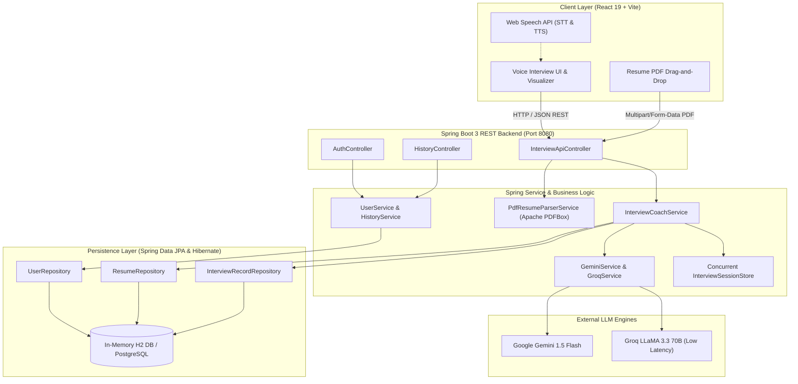
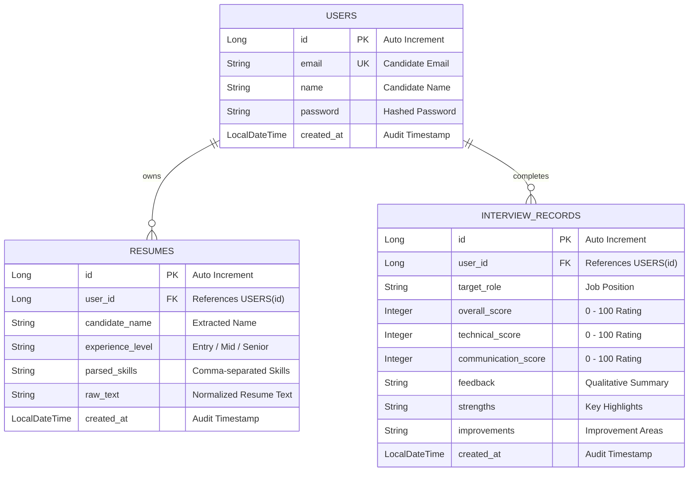

<div align="center">

# 🎙️ MockMate AI
### Enterprise AI Mock Interviewer & Coaching Platform
**Engineered with Java 17, Spring Boot 3, Spring Data JPA, Hibernate ORM & Generative AI**

<br/>

[](https://openjdk.org/)
[](https://spring.io/projects/spring-boot)
[](https://spring.io/projects/spring-data-jpa)
[](https://www.postgresql.org/)
[](https://maven.apache.org/)
[](https://react.dev/)
[](https://www.docker.com/)
[](LICENSE)

<br/>

<p align="center">
  <b>MockMate AI</b> is an enterprise-grade, full-stack autonomous AI interview coaching system. It performs server-side PDF resume parsing, generates adaptive technical interview questions, conducts low-latency voice interviews, and computes multidimensional hiring evaluation scorecards backed by persistent relational storage.
</p>

[Explore REST APIs](#-rest-api-documentation) • [System Architecture](#-system-architecture) • [JPA & Database Design](#-database-design--jpa-entities) • [Quick Start](#-quick-start)

---

</div>

## 📑 Table of Contents
1. [Executive Summary](#-executive-summary)
2. [System Architecture](#-system-architecture)
3. [Key Engineering Highlights (Java & Spring Boot Core)](#-key-engineering-highlights-java--spring-boot-core)
4. [Database Design & JPA Entities](#-database-design--jpa-entities)
5. [REST API Documentation & Payloads](#-rest-api-documentation)
6. [Design Patterns & Clean Code Principles](#-design-patterns--clean-code-principles)
7. [Repository Structure](#-repository-structure)
8. [Quick Start & Setup](#-quick-start)
9. [Author & Contact](#-author)

---

## 💡 Executive Summary

Traditional mock interviews either require expensive human coaches or rely on static, multiple-choice quizzes that fail to replicate real-world technical interview pressure. 

**MockMate AI** bridges this gap by combining an asynchronous, reactive **Spring Boot 3 REST API** backend with **Generative AI models (Google Gemini & Groq LLMs)**, **Apache PDFBox**, and a browser-native **Web Audio / Speech Recognition engine**:
* 📄 **Deep Resume Parsing**: Extracts candidate skills, tech stacks, and career experience levels from binary PDFs.
* 🎯 **Dynamic Adaptive Questioning**: Generates technical, scenario-based questions tailored specifically to the candidate's resume and target job role.
* 🎙️ **Real-time Voice Interviewer**: Conversational audio interface with dynamic follow-ups based on the candidate's actual spoken responses.
* 📊 **Multidimensional Scoring Rubric**: Produces detailed hiring assessments covering Technical Accuracy, Communication Clarity, Problem-Solving, and STAR-method alignment.
* 💾 **Relational Persistence**: All candidate profiles, interview sessions, and scorecard metrics are persisted via Spring Data JPA with H2/PostgreSQL.

---

## 🏛️ System Architecture



---

## ☕ Key Engineering Highlights (Java & Spring Boot Core)

### 1. Spring Boot 3.3 & Modern Java 17 Features
* Built on **Spring Boot 3.3.4** utilizing Java 17 language enhancements (Records, Pattern Matching, enhanced switch expressions, and stream pipelines).
* Strict separation of concerns following **Layered Clean Architecture**: Presentation (`controller`), Business Logic (`service`), Data Access (`repository`), and Domain Entities (`entity`).

### 2. Spring Data JPA & Hibernate 6 ORM
* **Declarative Repositories**: Leverages Spring Data `JpaRepository<T, ID>` with custom derived query methods (`findByEmail`, `findByUserIdOrderByCreatedAtDesc`).
* **Relational Mapping**: Robust schema modeling with `@Entity`, `@Table`, `@Id`, `@GeneratedValue(strategy = GenerationType.IDENTITY)`, `@Column`, and `@CreationTimestamp`.
* **Zero-Config Dual Database Setup**:
  * **Development**: In-Memory H2 database with web console enabled (`/h2-console`).
  * **Production Ready**: PostgreSQL dialect and HikariCP connection pool configuration ready in `application.properties`.

### 3. Server-Side Binary PDF Processing with Apache PDFBox
* Utilizes **Apache PDFBox 3.0.3** (`Loader.loadPDF`) to parse uploaded PDF byte streams directly in memory without disk I/O overhead.
* Normalizes candidate text, extracts technical keywords (Java, Spring, Microservices, SQL, AWS, React, etc.), and identifies experience levels.

### 4. High-Availability AI Orchestration with Resilient Fallbacks
* **Dual-Engine AI Client**: Integrates both Google Gemini and Groq API clients via Java `HttpURLConnection` and Jackson `ObjectMapper`.
* **Graceful Degradation**: If third-party AI endpoints experience rate limiting or network timeouts, the `InterviewCoachService` seamlessly falls back to a curated in-memory question pool (`QuestionPool.java`), ensuring uninterrupted interview sessions.

### 5. In-Memory Session Management
* Implements thread-safe session caching via `InterviewSessionStore` backed by `ConcurrentHashMap<String, InterviewSession>` to support multi-turn interview interactions with sub-millisecond lookups.

---

## 🗄️ Database Design & JPA Entities



---

## 🚀 REST API Documentation

Base URL: `http://localhost:8080/api`

### 1. Initialize Interview Session
* **Endpoint**: `POST /api/interview/start`
* **Content-Type**: `application/json`
* **Payload**:
```json
{
  "targetRole": "Java Backend Developer",
  "experienceLevel": "Fresher / Junior",
  "resumeSkills": ["Java 17", "Spring Boot", "JPA", "Hibernate", "PostgreSQL", "REST APIs"],
  "questionCount": 5
}
```
* **Response (`200 OK`)**:
```json
{
  "sessionId": "a7e3b91c-4d5f-42e1-8f92-93cb123e4567",
  "status": "INITIALIZED",
  "totalQuestions": 5,
  "firstQuestion": {
    "questionId": "Q1",
    "text": "Can you explain the internal working of HashMap in Java and how collisions are resolved?",
    "category": "Core Java / Data Structures",
    "difficulty": "Medium"
  }
}
```

### 2. Submit Answer & Receive AI Evaluation
* **Endpoint**: `POST /api/interview/evaluate`
* **Content-Type**: `application/json`
* **Payload**:
```json
{
  "sessionId": "a7e3b91c-4d5f-42e1-8f92-93cb123e4567",
  "questionId": "Q1",
  "candidateAnswer": "HashMap uses an array of buckets. Key hashCode is used to find index. In Java 8, LinkedList converts to Balanced Tree when threshold exceeds 8."
}
```
* **Response (`200 OK`)**:
```json
{
  "questionId": "Q1",
  "score": 92,
  "technicalAccuracy": "Strong understanding of Java 8 treeification threshold.",
  "communicationClarity": "Concise and technically accurate.",
  "followUpQuestion": "What happens if two different keys have the exact same hashCode?",
  "hasMoreQuestions": true
}
```

### 3. Parse PDF Resume
* **Endpoint**: `POST /api/interview/resume/parse`
* **Content-Type**: `multipart/form-data`
* **Response (`200 OK`)**:
```json
{
  "candidateName": "Prajakta Gudadhe",
  "experienceLevel": "Fresher / Junior",
  "extractedSkills": ["Java", "Spring Boot", "Spring Data JPA", "Hibernate", "REST APIs", "SQL", "Git"],
  "characterCount": 2480
}
```

### 4. Candidate Authentication & History
* `POST /api/auth/register` — User signup with JPA persistence.
* `POST /api/auth/login` — Candidate authentication & session token.
* `GET /api/history` — Fetch all previous interview attempt scorecards.
* `GET /h2-console` — In-browser H2 database query tool.

---

## 🧩 Design Patterns & Clean Code Principles

| Pattern / Principle | Implementation in MockMate AI |
| :--- | :--- |
| **Layered MVC Pattern** | Strict separation: `@RestController` -> `@Service` -> `JpaRepository` -> `@Entity`. |
| **Data Transfer Object (DTO)** | Request/response DTOs decouple internal database schemas from external API contracts. |
| **Repository Pattern** | Spring Data JPA encapsulates relational database interactions with type-safe interfaces. |
| **Strategy & Fallback Pattern** | Dynamic routing between Groq, Gemini, and offline question pools for zero downtime. |
| **Inversion of Control (IoC)** | Spring constructor dependency injection across all services and components. |
| **Single Responsibility (SOLID)** | Dedicated specialized services for PDF parsing, Auth, AI orchestration, and scoring. |

---

## 📂 Repository Structure

```text
MockMateAI/
├── ☕ src/
│   ├── main/
│   │   ├── java/com/mockmate/ai/
│   │   │   ├── MockMateAiApplication.java    # Spring Boot Main Entrypoint
│   │   │   ├── controller/                   # REST Controllers (@RestController)
│   │   │   │   ├── AuthController.java
│   │   │   │   ├── HistoryController.java
│   │   │   │   ├── InterviewApiController.java
│   │   │   │   └── SpaWebController.java
│   │   │   ├── entity/                       # Spring Data JPA Entities (@Entity)
│   │   │   │   ├── UserEntity.java
│   │   │   │   ├── ResumeEntity.java
│   │   │   │   └── InterviewRecordEntity.java
│   │   │   ├── repository/                   # JPA Repositories (JpaRepository)
│   │   │   │   ├── UserRepository.java
│   │   │   │   ├── ResumeRepository.java
│   │   │   │   └── InterviewRecordRepository.java
│   │   │   ├── service/                      # Business Logic & AI Services
│   │   │   │   ├── InterviewCoachService.java
│   │   │   │   ├── GeminiService.java
│   │   │   │   ├── GroqService.java
│   │   │   │   ├── PdfResumeParserService.java
│   │   │   │   ├── UserService.java
│   │   │   │   ├── HistoryService.java
│   │   │   │   └── InterviewSessionStore.java
│   │   │   └── model/                        # DTOs & Domain Models
│   │   │       ├── CandidateProfile.java
│   │   │       ├── EvaluationReport.java
│   │   │       ├── InterviewQuestion.java
│   │   │       ├── InterviewSession.java
│   │   │       └── QuestionPool.java
│   │   └── resources/
│   │       ├── application.properties        # Server port, JPA & H2 configurations
│   │       └── static/                       # REST API landing portal
│   └── test/
│       └── java/com/mockmate/ai/             # JUnit 5 & Spring Boot Test Suite
│           └── MockMateAiApplicationTests.java
│
├── ⚛️ frontend/                              # Modern React 19 + TailwindCSS Client
│   ├── src/                                  # Audio visualizer, voice controls, scorecards
│   ├── public/                               # Static icons and assets
│   ├── package.json
│   └── vite.config.ts
│
├── 📦 pom.xml                                # Maven Dependencies & Build Configuration
├── 🐳 Dockerfile                             # Multi-stage Container Deployment
├── 📄 README.md                              # Technical Documentation
├── 🚀 start-all.bat                          # 1-Click Full-Stack Launcher (Windows)
├── ⚙️ start-backend.bat                      # Spring Boot Launcher
└── 🎨 start-frontend.bat                     # React Vite Launcher
```

---

## 🛠️ Quick Start

### Prerequisites
* **Java Development Kit (JDK 17+)** — Ensure `JAVA_HOME` is configured.
* **Apache Maven 3.8+** (or bundled launcher)
* **Node.js (v18+)** — For the frontend UI.

### Option 1: 1-Click Launch (Windows)
Double-click [`start-all.bat`](start-all.bat) at the root. It automatically bootstraps both the Spring Boot REST backend and the React frontend in parallel.

### Option 2: Manual Launch

#### 1. Launch Spring Boot Backend
```bash
# In the root repository directory
mvn clean spring-boot:run
```
* **API Server**: `http://localhost:8080/api`
* **API Portal**: `http://localhost:8080/`
* **H2 Database Console**: `http://localhost:8080/h2-console`  
  *(JDBC URL: `jdbc:h2:mem:mockmatedb`, User: `sa`, Password: empty)*

#### 2. Launch React Frontend
```bash
# In the frontend directory
cd frontend
npm install
npm run dev
```
* **Frontend App**: `http://localhost:5173`

---

## 🧪 Testing & Code Quality
Run the automated test suite with Maven:
```bash
mvn test
```
The application executes context loading tests via `@SpringBootTest` and JUnit 5 to ensure dependency injection, JPA mappings, and bean configurations are verified.

---

## 👩‍💻 Author

**Prajakta Gudadhe**  
*Java Full-Stack Developer | Spring Boot & Cloud AI Enthusiast*  
* 🐙 **GitHub**: [@prajakta2905](https://github.com/prajakta2905)  
* 📧 **Email**: prajaktagudadhe068@gmail.com  

---

<div align="center">
  <sub>Built with ❤️ using Java 17, Spring Boot 3, Spring Data JPA, and Generative AI.</sub>
</div>
