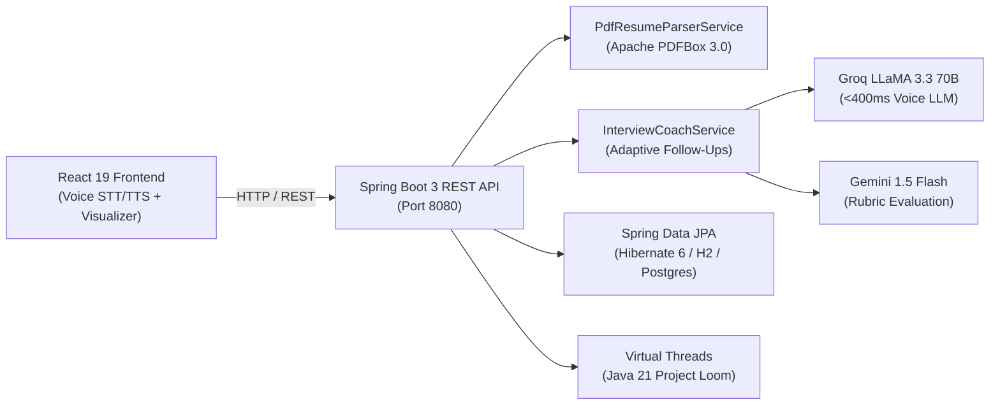

# 🎙️ MockMate AI — Autonomous Voice & Resume AI Interviewer

<p align="center">
  <a href="https://mockmate-gate-9872.onrender.com">
    
  </a>
</p>

<p align="center">
  
  
  
  
  
  
  
  
  
</p>

---

## 💡 Overview

**MockMate AI** is an enterprise-grade AI mock interview platform that simulates realistic technical interviews using real-time voice (STT/TTS) and intelligent resume parsing. 

Candidates upload their resume (PDF), and the system extracts skills, projects, and work experience using **Apache PDFBox**, then conducts an adaptive technical interview powered by ultra-low-latency **Groq (LLaMA 3.3 70B)** and **Gemini 1.5 Flash**. The full-stack app is packaged as a unified single-container Docker service running on **Java 21 LTS**, **Spring Boot 3.3**, and **React 19**.

🔗 **Live URL**: [https://mockmate-gate-9872.onrender.com](https://mockmate-gate-9872.onrender.com)

---

## 🏛️ System Architecture



---

## 📂 Project Structure (Interviewer Quick-Guide)

A clean separation of concerns between backend enterprise APIs, frontend voice UI, and production containerization:

```
MockMate-AI/
├── src/main/java/com/mockmate/ai/       # ☕ Java 21 Spring Boot Enterprise Backend
│   ├── controller/                      # 📡 REST API Controllers
│   │   ├── InterviewApiController.java  # Core endpoints: questions, answer evaluation, reports
│   │   ├── AuthController.java          # User registration & authentication
│   │   ├── HistoryController.java       # User practice history & scorecard retrieval
│   │   ├── KeepAliveController.java     # Self-ping health check for cloud containers
│   │   └── SpaWebController.java        # Single Page App routing forwarder
│   ├── service/                         # 🧠 Core Business & AI Logic
│   │   ├── PdfResumeParserService.java  # In-memory PDF stream parsing (Apache PDFBox 3.0)
│   │   ├── InterviewCoachService.java   # Dynamic question generation & rubric evaluation
│   │   ├── GroqService.java             # Ultra-fast voice LLM integration (<400ms TTFT)
│   │   ├── GeminiService.java           # Multimodal rubric grading & secondary fallback
│   │   ├── HistoryService.java          # Persisting interview session scores
│   │   └── KeepAliveService.java        # Scheduled background ping for free-tier uptime
│   ├── entity/                          # 🗄️ JPA Database Entities (User, InterviewRecord, Resume)
│   ├── repository/                      # 💾 Spring Data JPA Repositories (CRUD & queries)
│   └── model/                           # 📦 Request / Response DTO models
│
├── frontend/                            # ⚛️ React 19 + Vite Modern Frontend
│   ├── src/
│   │   ├── components/                  # 🎨 Reusable UI Components
│   │   │   ├── InterviewScreen.jsx      # Live interview screen with speech & AI interaction
│   │   │   ├── AudioVisualizer.jsx      # Real-time microphone audio wave visualizer
│   │   │   ├── ResumeUpload.jsx         # Drag-and-drop PDF upload & skill extraction
│   │   │   ├── InterviewReport.jsx      # Comprehensive performance scorecard & metrics
│   │   │   └── HeroLanding.jsx          # Interactive landing page with feature showcase
│   │   └── services/                    # 🔌 Frontend Services & API Integrations
│   │       ├── speechService.js         # Browser Web Speech API (STT recognition & TTS voice)
│   │       ├── javaBackendService.js    # Seamless Spring Boot REST client with offline fallback
│   │       └── grok.js / gemini.js      # Client-side direct AI connectors & prompt builders
│
├── Dockerfile                           # 🐳 Multi-Stage Dockerfile (Node 20 -> Maven -> JRE 21)
├── pom.xml                              # 📦 Maven Config (Java 21, Spring Boot 3.3.4, PDFBox 3.0.3)
└── start-all.bat                        # ⚡ 1-Click Local Dev Launcher (Starts Frontend & Backend)
```

---

## ⚡ Core Engineering Highlights

* **High-Throughput Virtual Threads (Project Loom)**: Leverages Java 21 Virtual Threads (`spring.threads.virtual.enabled=true`) for non-blocking concurrent candidate voice sessions with minimal memory footprint.
* **Layered Clean Architecture**: Built with strict separation (`Controller` ➔ `Service` ➔ `Repository` ➔ `Entity`), input validation, and centralized exception handling.
* **In-Memory PDF Resume Parsing**: Uses **Apache PDFBox 3.0** on the server to parse PDF streams entirely in memory without writing sensitive user files to disk.
* **Ultra-Low Latency Voice (<400ms)**: Combines browser-native **Web Speech API** with **Groq Cloud (LLaMA 3.3 70B)** for fluid conversational responsiveness.
* **Adaptive Questioning**: Follow-up questions dynamically adjust based on candidate answers — challenging strong candidates deeper and guiding beginners.
* **Single-Container Full-Stack Docker**: Multi-stage build compiles React assets directly into Spring Boot's static resources, yielding a standalone, production-ready JRE 21 container.
* **Relational Persistence**: Uses **Spring Data JPA** with Hibernate 6 and includes an interactive H2 console (`/h2-console`) for rapid local testing, compatible with PostgreSQL in production.

---

## 📡 REST API Reference

| Method | Endpoint | Description |
|:---:|---|---|
| `GET` | `/api/status` | Backend health, database connectivity & AI readiness |
| `POST` | `/api/resume/parse` | Server-side binary PDF resume extraction via Apache PDFBox |
| `POST` | `/api/interview/questions` | Generates role-tailored interview question pool |
| `POST` | `/api/interview/evaluate-answer` | Evaluates candidate answer & generates dynamic follow-up |
| `POST` | `/api/interview/report` | Generates comprehensive interview scorecard & rating |
| `GET` | `/api/history` | Fetches historical interview records from database |
| `POST` | `/api/auth/signup` / `/login` | User registration and authentication |

---

## 🚀 Quick Start Locally

### Prerequisites
* **Java 21+** (JDK) & **Node.js 18+**

### 1-Click Launch (Windows)
Double-click [`start-all.bat`](start-all.bat) to boot both the Spring Boot Backend (`8080`) and Vite Frontend (`5173`).

### Manual Launch (Terminal)
```bash
# 1. Start Java Backend (Terminal 1)
mvn clean spring-boot:run

# 2. Start React Frontend (Terminal 2)
cd frontend && npm install && npm run dev
```

* **Frontend UI**: `http://localhost:5173`
* **Backend API**: `http://localhost:8080/api/status`
* **H2 Console**: `http://localhost:8080/h2-console` *(JDBC URL: `jdbc:h2:mem:mockmatedb`)*

---

## 🐳 Docker Deployment

To build and run the unified full-stack image locally:

```bash
docker build -t mockmate-ai .
docker run -p 8080:8080 -e PORT=8080 mockmate-ai
```
Open `http://localhost:8080` in your browser.

---

## 👩‍💻 Author

**Prajakta Gudadhe**  
*Full Stack Software Engineer & Java Developer*  
* **GitHub**: [@prajakta2905](https://github.com/prajakta2905)  
* **Email**: [prajaktagudadhe068@gmail.com](mailto:prajaktagudadhe068@gmail.com)
