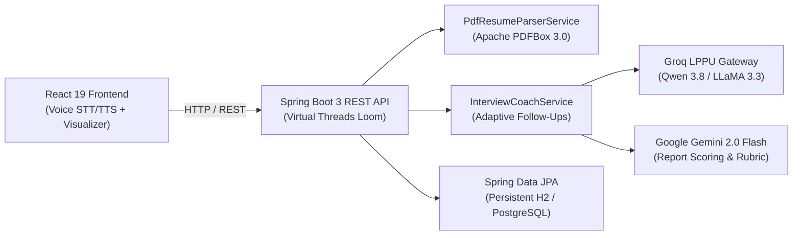

# 🎙️ MockMate AI — Voice & Resume AI Interview Platform

<p align="center">
  <a href="https://mockmate-gate-9872.onrender.com">
    
  </a>
</p>

<p align="center">
  
  
  
  
  
  
  
  
  
</p>

---

## 💡 Overview

**MockMate AI** is a full-stack automated technical interview platform with voice-driven interaction, resume parsing, and dynamic adaptive follow-up questioning.

Candidates upload their resume (PDF), and the system extracts skills, projects, and work experience using **Apache PDFBox**, then conducts an interactive technical interview powered by **Groq (Qwen 3.8 27B / LLaMA 3.3 70B)** and **Google Gemini 2.0 Flash**. The full-stack app is packaged as a unified single-container Docker service running on **Java 21 LTS**, **Spring Boot 3.3**, and **React 19**.

🔗 **Live URL**: [https://mockmate-gate-9872.onrender.com](https://mockmate-gate-9872.onrender.com)

---

## 🏛️ System Architecture



---

## 📂 Project Structure (Interviewer Quick-Guide)

A clean separation of concerns between backend domain services, frontend voice UI, and production containerization:

```
MockMate-AI/
├── src/main/java/com/mockmate/ai/       # ☕ Java 21 Spring Boot Backend
│   ├── config/                          # ⚙️ SecurityConfig (BCryptPasswordEncoder bean)
│   ├── controller/                      # 📡 REST API Controllers
│   │   ├── AiProxyController.java       # Server-side AI proxy gateway (Groq & Gemini)
│   │   ├── InterviewApiController.java  # Questions, live answer evaluation, scorecards
│   │   ├── AuthController.java          # User registration & BCrypt authentication
│   │   ├── HistoryController.java       # User practice history & scorecard retrieval
│   │   ├── KeepAliveController.java     # Self-ping health check for cloud containers
│   │   └── SpaWebController.java        # Single Page App routing forwarder
│   ├── service/                         # 🧠 Core Business & AI Logic
│   │   ├── PdfResumeParserService.java  # In-memory PDF stream parsing (Apache PDFBox 3.0)
│   │   ├── InterviewCoachService.java   # Dynamic question generation & rubric evaluation
│   │   ├── GroqService.java             # Low-latency voice LLM integration (~200-350ms TTFT)
│   │   ├── GeminiService.java           # Multimodal rubric grading & secondary fallback
│   │   ├── HistoryService.java          # Persisting interview session scores
│   │   └── KeepAliveService.java        # Scheduled background ping for free-tier uptime
│   ├── entity/                          # 🗄️ JPA Database Entities (User, InterviewRecord, Resume)
│   ├── repository/                      # 💾 Spring Data JPA Repositories (CRUD & queries)
│   └── model/                           # 📦 Request / Response DTO models
│
├── frontend/                            # ⚛️ React 19 + Vite Modern Frontend
│   ├── src/
│   │   ├── components/                  # 🎨 Reusable UI Components
│   │   │   ├── InterviewScreen.jsx      # Live interview screen with speech & AI interaction
│   │   │   ├── AudioVisualizer.jsx      # Real-time microphone audio wave visualizer
│   │   │   ├── ResumeUpload.jsx         # Drag-and-drop PDF upload & skill extraction
│   │   │   ├── InterviewReport.jsx      # Comprehensive performance scorecard & metrics
│   │   │   └── HeroLanding.jsx          # Interactive landing page with feature showcase
│   │   └── services/                    # 🔌 Frontend Services & API Integrations
│   │       ├── speechService.js         # Browser Web Speech API (STT recognition & TTS voice)
│   │       ├── javaBackendService.js    # Seamless Spring Boot REST client with offline fallback
│   │       └── grok.js / gemini.js      # Frontend AI connectors routed through backend proxy
│
├── Dockerfile                           # 🐳 Multi-Stage Dockerfile (Node 20 -> Maven -> JRE 21)
├── pom.xml                              # 📦 Maven Config (Java 21, Spring Boot 3.3.4, PDFBox 3.0.3)
└── start-all.bat                        # ⚡ 1-Click Local Dev Launcher (Starts Frontend & Backend)
```

---

## ⚡ Core Engineering Highlights

* **BCrypt Credential Hashing**: User passwords and demo accounts are salted and hashed using **BCrypt** (12 rounds) with constant-time matching. Plaintext passwords are never stored in the database or logged.
* **Zero-Exposure Server-Side AI Gateway**: Private Groq and Gemini API keys remain 100% on the server. Requests from the browser route through `/api/ai/groq` and `/api/ai/gemini`, preventing API key exposure in client bundles or network URLs.
* **Persistent Relational Database & Cloud Readiness**: Configured with file-based persistent H2 storage (`jdbc:h2:file:./data/mockmatedb`) so user accounts, resumes, and interview history survive container and server restarts. Zero-code transition to PostgreSQL (Render Postgres, Supabase, AWS RDS) via standard `SPRING_DATASOURCE_URL` or `DATABASE_URL` environment variables.
* **Production Security Defaults**: H2 web console is disabled by default (`H2_CONSOLE_ENABLED=false`) to eliminate remote attack surfaces.
* **High-Throughput Virtual Threads (Project Loom)**: Leverages Java 21 Virtual Threads (`spring.threads.virtual.enabled=true`) for non-blocking concurrent candidate voice sessions with minimal memory footprint.
* **Low-Latency Voice Turnaround**: Combines client-side browser Web Speech API (zero server network transmission hop for speech recognition) with Groq LPPU inference (~200-350ms Time-To-First-Token). Total conversational turnaround typically completes within ~500ms to 900ms depending on network conditions.
* **In-Memory PDF Resume Parsing**: Uses **Apache PDFBox 3.0** on the server to parse PDF streams directly in memory without writing user files to disk.
* **Single-Container Full-Stack Docker**: Multi-stage build compiles React assets directly into Spring Boot's static resources, yielding a standalone, production-ready JRE 21 container.

---

## 📡 REST API Reference

| Method | Endpoint | Description |
|:---:|---|---|
| `GET` | `/api/status` | Backend health, database connectivity & AI readiness |
| `POST` | `/api/ai/groq` | Secure server-side Groq proxy (preserves private credentials) |
| `POST` | `/api/ai/gemini` | Secure server-side Gemini proxy (headers-only authentication) |
| `GET` | `/api/ai/status` | Real-time status of configured AI inference providers |
| `POST` | `/api/resume/parse` | Server-side binary PDF resume extraction via Apache PDFBox |
| `POST` | `/api/interview/questions` | Generates role-tailored interview question pool |
| `POST` | `/api/interview/evaluate-answer` | Evaluates candidate answer & generates dynamic follow-up |
| `POST` | `/api/interview/report` | Generates comprehensive interview scorecard & rating |
| `GET` | `/api/history` | Fetches historical interview records from database |
| `POST` | `/api/auth/signup` / `/login` | User registration and authentication with BCrypt |

---

## 🎯 Architecture Decisions (Interviewer Q&A)

Here are the key engineering design decisions you can discuss during technical interviews:

#### 1. Why route Groq and Gemini calls through the Spring Boot backend?
> **Answer:** If frontend code calls third-party AI APIs directly, API keys must either be bundled into Vite production assets (`VITE_` variables) or stored in browser `localStorage`. Anyone opening browser DevTools can inspect network requests or JS bundles and steal developer API quotas. By proxying calls through `/api/ai/*`, credentials stay strictly server-side, and the backend can apply rate limiting, prompt sanitization, and fallback orchestration.

#### 2. How do you handle database persistence across Render / container restarts?
> **Answer:** By default, H2 in in-memory mode (`jdbc:h2:mem:...`) discards all state when the JVM stops. We configured file-based H2 persistence (`jdbc:h2:file:./data/mockmatedb`) so single-node containers retain accounts and interview history. For multi-replica production environments, the Spring Boot DataSource is parameterized to bind to external PostgreSQL (e.g., Supabase or Render Postgres) via `SPRING_DATASOURCE_URL` or `DATABASE_URL` without changing code.

#### 3. Why is the H2 Console disabled by default in production?
> **Answer:** Enabling the H2 web console (`/h2-console`) on a public URL provides an unauthenticated web interface where attackers could execute arbitrary SQL queries against user tables. Disabling it by default (`H2_CONSOLE_ENABLED=false`) follows the principle of least privilege and reduces the attack surface.

#### 4. Why use Java 21 Virtual Threads (Project Loom)?
> **Answer:** Voice interview sessions spend the majority of their lifecycle blocked on external I/O (waiting for LLM token streams or database queries). Traditional platform threads consume ~1MB of stack memory each and are limited by OS thread pools. Java 21 Virtual Threads allow Tomcat to allocate millions of lightweight user-mode threads, maintaining high concurrency without thread pool starvation.

#### 5. How is voice latency optimized?
> **Answer:** Speech-to-Text (STT) and Text-to-Speech (TTS) run on the browser's native Web Speech API, removing the need to stream multi-megabyte audio files over the network to the server. The backend only transfers lightweight JSON prompts, allowing Groq's LPPU hardware to generate response tokens with sub-350ms Time-To-First-Token.

---

## 🚀 Quick Start Locally

### Prerequisites
* **Java 21+** (JDK) & **Node.js 18+**

### 1-Click Launch (Windows)
Double-click [`start-all.bat`](start-all.bat) to boot both the Spring Boot Backend (`8080`) and Vite Frontend (`5173`).

### Manual Launch (Terminal)
```bash
# 1. Start Java Backend (Terminal 1)
mvn clean spring-boot:run

# 2. Start React Frontend (Terminal 2)
cd frontend && npm install && npm run dev
```

* **Frontend UI**: `http://localhost:5173`
* **Backend API**: `http://localhost:8080/api/status`
* **H2 Console** *(Optional in dev: set `H2_CONSOLE_ENABLED=true`)*: `http://localhost:8080/h2-console`

---

## 🐳 Docker Deployment

To build and run the unified full-stack image locally:

```bash
docker build -t mockmate-ai .
docker run -p 8080:8080 -e PORT=8080 mockmate-ai
```
Open `http://localhost:8080` in your browser.

---

## 👩‍💻 Author

**Prajakta Gudadhe**  
*Full Stack Software Engineer & Java Developer*  
* **GitHub**: [@prajakta2905](https://github.com/prajakta2905)  
* **Email**: [prajaktagudadhe068@gmail.com](mailto:prajaktagudadhe068@gmail.com)
